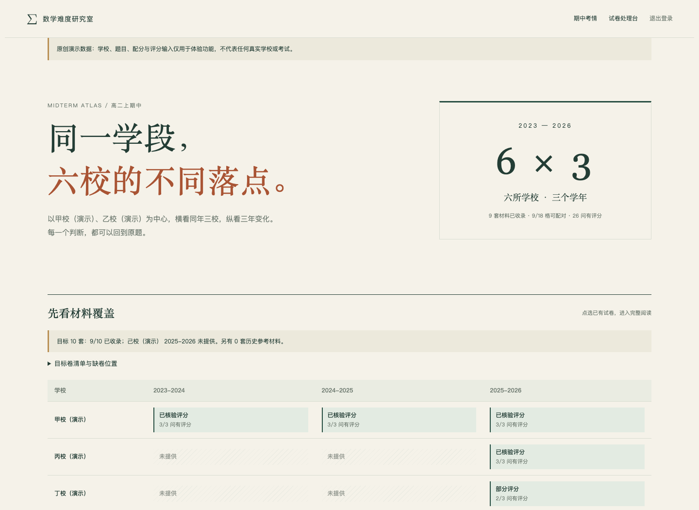
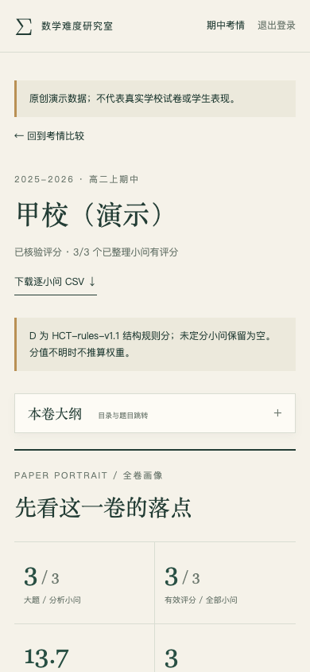

# Math Difficulty Studio 产品使用手册

面向教师与维护者。本项目将完整题目、答案解析、人工评分证据与可复算规则分组织成阅读页和比较看板。适合试卷讲评准备、共同范围对照、方法专题选题与资料版本管理。

**先明确边界：** OCR 产生识别草稿；程序复算既有证据。自动解题、自动生成评分证据、数学自动审核与远程 AI 执行尚未接入。图表不能替代原题、数学核验或真实学生作答证据。

## 1. 第一次安装与启动

要求 Node.js 22、Python 3.10+，使用 macOS、Linux 或 Windows WSL。依赖安装需要联网；原创演示不需要模型密钥。

在仓库根目录执行：

```sh
git clone https://github.com/cheng-bai/math-difficulty-studio.git
cd math-difficulty-studio
npm ci
python3 -m venv .venv
source .venv/bin/activate
python3 -m pip install -r requirements-content.txt
npm run content:init
npm run midterms:demo
npm run local
```

打开 <http://127.0.0.1:3102>。保持终端运行，按 `Ctrl+C` 停止网页和本地 OCR worker。下次启动先进入仓库、激活 `.venv`，再运行 `npm run local`。未配置 MinerU 时仍可阅读示例，OCR 显示未配置。

`content:init` 初始化已有原创题组及本地 KaTeX 资源，保留已存在内容。`midterms:demo` 生成并导入期中原创演示；已有非演示期中发布指针时拒绝自动覆盖。无需重复初始化即可日常阅读。

| 入口 | 用途 |
| --- | --- |
| `/` | 首页与导航 |
| `/workbench` | 本地 OCR 任务、草稿预览与下载 |
| `/national/demo/试卷难度分析.html` | 既有原创题组与版本维护演示 |
| `/midterms` | 期中覆盖、比较、考频与逐卷阅读 |
| `/login` | 非本机免登录模式下的账号登录 |

完整期中演示包含 **9 卷、27 小问、26 问定分、1 问刻意待核、1 问缺配分**。甲至己均为虚构显示名；内部沿用现有六校键以兼容固定比较布局。甲、乙各有三年示例，丙、丁、戊有同年示例，己同年模拟缺卷。数值变化用于体验功能，不能据此评价真实学校。



## 2. 教师首次阅读：从覆盖到原题

建议按以下顺序操作：

1. 打开 `/midterms`，查看资料覆盖矩阵。先分清缺卷、已整理与有效评分覆盖，再开始比较。
2. 核对考试范围、总分、时长和题型。不同内容范围造成的差异，应先于难度均值解释。
3. 在“完整图表工作台”选择同年横向、中心校纵向或全部已收录。按主模块与方法缩小共同内容。
4. 查看模块占比、难度分布、H/C/T和题序；点击题号回到完整题目、图形、解答与评分证据。
5. 将讲评结论落在具体题号与关键步骤，例如“本题先判断顶点是否位于定义域”，避免只使用均值或排名。

### 总览中的筛选各管什么

- 工作台的比较视角、主模块与方法共同影响该工作台的卷卡、图表和题目索引。筛选后的有效小问数与比例随之重算；先看分母，再比较百分比。
- 上方单卷观察、横向对齐、三年轨迹与考频有各自控件，不受工作台筛选统一控制。
- 三年考频中的学校、统计层级与查找仅控制考频表。原考点标签按文字精确匹配，近义标签不自动合并；跨年优先看主模块。
- 下载的 CSV 是本快照的**全量统计**，不随当前网页筛选变成筛选结果。

### 逐卷页：大纲、考点与证据

逐卷页左侧是可检索的阅读大纲，包含章节、题号、主模块和定分状态；手机上折叠显示。点题号、模块题号链接或题序柱可跳到原题。

“全卷画像”“考点总览”和模块矩阵展示全卷；考点与方法切换、查找仅筛选标签行，不改变全卷画像。多标签涉及同一小问时可以重叠，比例不能相加为 100%。

“负担探索”支持主模块、方法、难度三重交集筛选，联动小问列表、C/T散点和证据卡。待核问不绘成零分点；无匹配时用重置清除条件。选择一题后可以固定，与另一题并排查看评分证据；固定的是当前快照中的已渲染卡片。

散点横轴与纵轴分别表示 C、T；颜色表示 D 档次，点大小表示 B。它们帮助定位“连续推进较多”和“遗漏/返工风险较多”的不同题目，不表示学生得分与用时。




## 3. 正确理解规则分与覆盖率

| 字段 | 阅读方式 |
| --- | --- |
| K 知识与方法识别 | 0：题面直接对应公式/定义；1：标准变式转换；2：未显露关系或非常规组合 |
| R 条件转换与推理 | 0：单步直接推得；1：两三次常见转换；2：隐含条件、逆向构造或长依赖 |
| A 代数运算负荷 | 0：一两步常规运算；1：中等化简或联立；2：长符号链或复杂含参运算 |
| V 表征转换 | 0：不需要；1：一次文字、图像、公式或坐标间转换；2：多次或双向转换 |
| P 参数、新定义与边界 | 0：无额外负担；1：单一参数/边界；2：多分支、复杂量词或相互制约边界 |
| I 知识交汇 | 0：单模块；1：两模块浅层配合；2：不同模块在同一关键推理中深度耦合 |
| H | 单步最高结构负荷，由六维权重计算 |
| C | 正确路线中依赖路径的连续推进负担；重复与深度按引擎规则处理 |
| T | 五项各 0—2：入口隐蔽、无效入口、错误发现延迟、返工范围、端点/等号/退化遗漏；必须逐项说明，不把计算步骤长自动记作 T |
| D | `0.45H + 0.35C + 0.20T` 按引擎规则取整；基础 `<35`，中档 `35—64`，难题 `≥65` |
| B | 独立的关键突破等级 0—3，必须留依据，不加入 D |
| 必做分支 | 必须完成的分支数量；分支多可能带来单条路径 C 未覆盖的工作量 |

D 是 HCT-rules-v1.1 的结构规则分，未经真实学生作答数据校准。不得直接换算失分率、区分度、完成率或作答时间，一两分差异也不宜解释为实质难度变化。三年图仅描述所提供三份卷的变化，不预测下一年命题。

**待核不是 0。** 缺条件、题图不全、答案争议或评分依据未核验的问应标待核，保留问题说明，从确定评分均值和难度分布排除，并显示有效小问覆盖率。

**缺配分不均摊。** 未知的小问分值用 `null`；不把大题总分均分给小问。等权小问统计仍可用。已知分值图使用其明确标注的子集分母；只有全部小问配分明确时才显示加权指数。有待核问时该指数仅描述已分析部分。若总分与小问分值都不足，完整有效分值覆盖率保持未知。

主模块唯一，用于题量与分值汇总；知识点、方法、题素采用多标签统计。跨卷规则参数或步骤词典指纹不同会暂停相关难度比较，应先统一规范再导入。

## 4. 把自己的材料整理成期中包

### 4.1 OCR 与人工校对

按 [本地 OCR 配置](../LOCAL_OCR.md) 安装并配置 MinerU，启动本地网站，在 `/workbench` 提交一份 PDF 或图片。远程后端逐文件要求同意；本地网站运行不代表 OCR 离线。

下载含 Markdown、结构信息与题图的 ZIP。OCR 成功只表示得到草稿：逐页对照原件校验题号、小问、条件、公式、选项和题图，再独立检查答案、证明、定义域、端点及漏解。保留原件与疑点依据。学生稿与教师稿应分开制作，避免学生稿泄露答案。

网页当前不会自动把 OCR 草稿拆成完整期中评分包，也不会自动解题或生成教学结论；这些环节由维护者整理。

### 4.2 题目结构与评分证据

期中包结构见 [输入与发布规范](midterms.md)。可先生成原创示例到新目录，作为结构模板：

```sh
python3 scripts/setup-midterms-demo.py --output /tmp/my-midterms-template
```

生成器不读取真实试卷；目标不存在时创建，已存在时只有逐文件完全相同才接受，绝不覆盖不同内容。不要在修改过的模板目录重跑生成器。

在 `paper.json` 中填完整题目、答案、解析、主模块、标签和相对题图路径。在 `analysis-input.json` 中逐问建立步骤、六维证据、依赖、五项 T 与 B 依据。未知项用待核状态，不能当零补齐。算法参数与词典应保持一致。

调用现有 `modules/studio/scoring.py` 的 `score_question` 或 `score_paper` 复算；`delivery/评分明细.json` 保存每问的 `{evidence, computed}`。不要手填最终 H/C/T/D。可运行的安全导出示例见 [正式评分输入与明细](midterms.md#3-正式评分输入与明细)。期中导入器校验结构与身份、读取正式明细，不会自行判断证据在数学上是否正确。

### 4.3 预览、导入与恢复

在激活虚拟环境的仓库根目录执行，替换示意路径：

```sh
npm run midterms:preview -- --source /path/to/source
npm run midterms:import -- --source /path/to/source
```

预览完整渲染并验证，在临时目录完成后清理，不改变当前发布。导入完整生成成功才切换 `private/midterms/current.json`，产物保存在 `private/midterms/releases/<releaseId>/`。相同输入复用相同快照；来源渲染期间被修改时拒绝发布。

导入后检查总览、逐卷题干、公式、题图、跳转、覆盖率与 CSV，记录返回的 `releaseId`。入口 `/midterms` 指向当前版本；页面内部带快照摘要的地址保持历史版本，不会自动变成最新版。

保留旧快照即可恢复：

```sh
npm run midterms:rollback -- <releaseId>
```

请替换 `<releaseId>`，不要保留尖括号。回滚目标必须是已经存在、可核验的期中快照。不要手动编辑快照文件或指针来绕过完整性检查。回滚切换展示版本，不改写源输入。

期中内容是独立版本库，不使用既有原创题组的 ChangeSet 修改接口。旧题组编辑与回退仍按 [README](../README.md#修改题目) 执行。

## 5. 下载与资源更新

总览下载包括：逐卷统计 `summary.csv`、小问评分 `units.csv`、目标覆盖 `targets.csv`、卷面内容范围 `progress.csv`、三年考频 `frequency.csv`；并有快照 `data.json`。CSV 使用 UTF-8 BOM，便于表格软件打开。待核数值留空，导出后不要把空值批量替换为 0。

阅读页提供完整转录与教师分析阅读；需要源 Markdown 时从自行保留的输入包归档获取。OCR ZIP 是工作台单独的任务下载，不等于期中快照下载。自定义输入包、题图、发布产物均在 Git 忽略范围，不会随代码自动上传。

资源导航与更新办法见 [资源索引](RESOURCES.md)。补卷或修订时在输入包新增/修正来源与证据，先预览再导入，保留旧发布号。不要用别的学年替代缺卷，或把同卷学生版、答案版重复计为两卷。

## 6. 登录与部署

`npm run local` 仅监听 `127.0.0.1:3102`，本机模式免登录。需要受邀登录时先停止本地服务，再执行：

```sh
node scripts/create-account.mjs admin
npm run dev
```

`npm run dev` 默认端口为 3000。账号密码保存在 `.local/登录账号.txt`，不要提交或分享。创建器拒绝覆盖既有 `.env.local` 与凭据；已有配置请使用 [账号维护脚本](../scripts/manage-account.mjs)，不要通过删除配置文件解决问题。

非本机模式下，期中 HTML、数据、图片、脚本、字体与下载沿用受保护路由；登录后返回被访问的页面。可选 Supabase 配置见 [SUPABASE_AUTH.md](../SUPABASE_AUTH.md)。账号登录只是访问控制，不能替代素材使用与分发授权。

本机生产预览：

```sh
npm run local:build
npm run local:start
```

标准 Node.js 生产服务使用 `npm run build`、`npm start`；它与本机免登录启动器不同，需正确配置认证。Vercel 等云平台需自行创建项目与配置高熵密钥、账号或 Supabase，将已生成内容与本地 KaTeX 资源纳入部署包。只有 Git 代码而没有内容初始化/导入步骤时，期中页面没有数据。

仓库不含真实学校试卷、私人数据、既有部署项目关联或密钥。当前文件内容库不适合多个实例同时写入；云端 OCR 默认关闭。要提供多用户上传服务，仍需共享存储、持久队列与权限设计。不要在公网开放本机免登录模式。

## 7. 常见问题

| 现象 | 检查与处理 |
| --- | --- |
| `npm` 报 Node 版本不符 | 使用 Node.js 22，重新执行 `npm ci` |
| 找不到 `markdown_it` / `jsonschema` | 激活 `.venv` 后安装 `requirements-content.txt`，确认命令使用同一 Python |
| `/midterms` 无内容 | 先 `content:init`，再 `midterms:demo`；自有资料使用明确 `--source` 导入 |
| 演示命令拒绝覆盖 | 已有非演示期中指针或示例目录被修改；使用新的输出目录并明确预览/导入，不删除私有数据 |
| 3102 被占用 | 停止自己的旧进程，或用 `STUDIO_PORT=3103 npm run local`；不要终止不明进程 |
| 公式/题图缺失 | 检查初始化、相对路径与公式语法；修源包后重新导入，别改历史发布目录 |
| 刚导入但看到旧内容 | 从 `/midterms` 重开；带 `/releases/<releaseId>/` 的旧链接保持旧版 |
| 筛选后没有题目 | 清除筛选；逐卷三条件采用交集，待核问没有散点 |
| 比较被暂停 | 统一算法参数、版本和词典，再复算与导入；不要仅改指纹字段 |
| 下载留空、加权值不显示 | 查看待核与缺配分说明；空值有含义，不能补成零 |
| OCR 不可用或卡住 | 查看 `/workbench` 配置与失败记录；按 OCR 文档配置后重试，远程重试可能再次外发 |
| 资源完整性校验失败 | 保留现场与旧版本；从可信源重新生成或回退已核验快照，不绕过校验 |

## 8. 维护验证

依赖初始化后执行：

```sh
npm test
npm run test:content
python3 -m unittest discover -s tests -p 'test_midterms*.py'
npm run content:check
npm run check:public
npm run build
```

浏览器测试需先安装开发依赖与 Chromium，并已有生产构建：

```sh
python3 -m pip install -r requirements-dev.txt
python3 -m playwright install chromium
npm run test:browser
```

程序测试通过不代表数学审核完成。发布自己的资料前，仍需实际打开桌面和手机页，抽查公式、图形与教师可用性，并验证未登录时资源保护有效。第三方许可见 [THIRD_PARTY_NOTICES.md](../THIRD_PARTY_NOTICES.md)，代码和原创演示许可见 [LICENSE](../LICENSE)。
