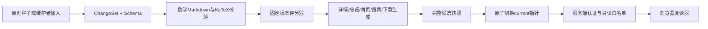

# 模块与数据流

- `modules/studio/scoring.py`：纯规则计算，不调用模型。
- `domain.py`：合同、题目来源、步骤依赖与统计分母。
- `rendering.py`：安全Markdown、统一模型与输出生成。
- `repository.py`：单机写锁、题目版本与发布版本、请求幂等、不可变快照、原子切换和回退。
- `scripts/studio.py`：维护CLI。原子内容切换只发生在本机文件仓库，远端并不执行这些Python代码。
- `lib/content-release.mjs`：读当前版本、检查资源哈希、按白名单交付。
- `modules/ocr`：可选本地任务及外部CLI适配，与评分器解耦。
- `lib/security.mjs`、`lib/supabase`：两种明确选定的认证适配，不在失败时自动降级。

构建需要Python、Node和依赖；运行Node服务只读生成产物。初始示例不需要任何云账号或OCR密钥。源码库、内容快照与任务目录各有不同生命周期；后两者不提交Git。

当前是一份可编辑题组的文件型参考实现。为支持多用户、多实例或远程独立内容发布，应替换仓库适配层并保留revision/CAS/幂等合同，不能直接把本地免登录/OCR路由暴露到公网。
